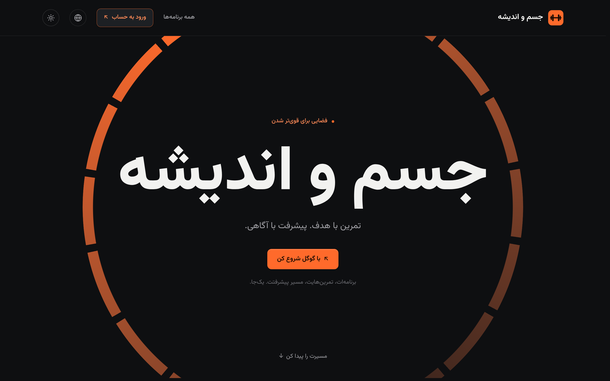
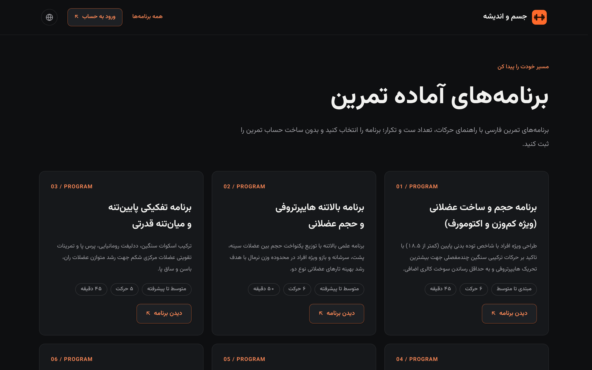
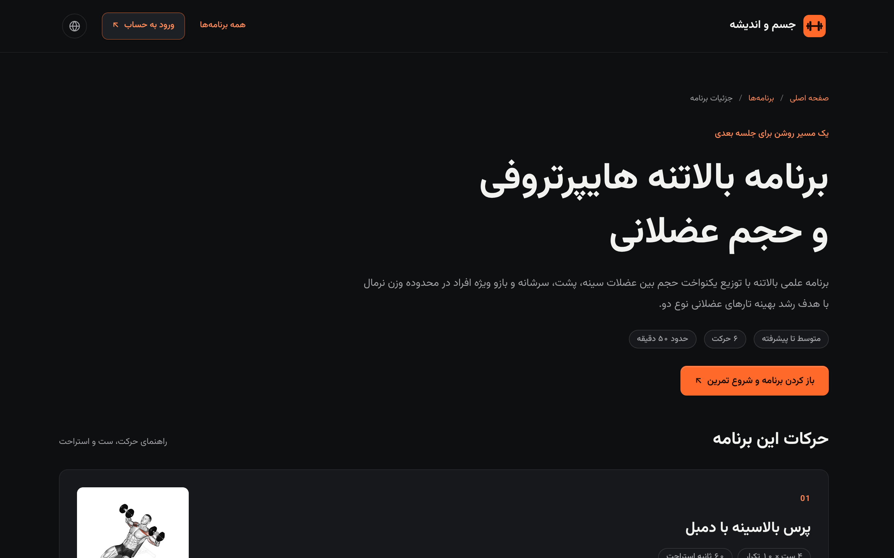
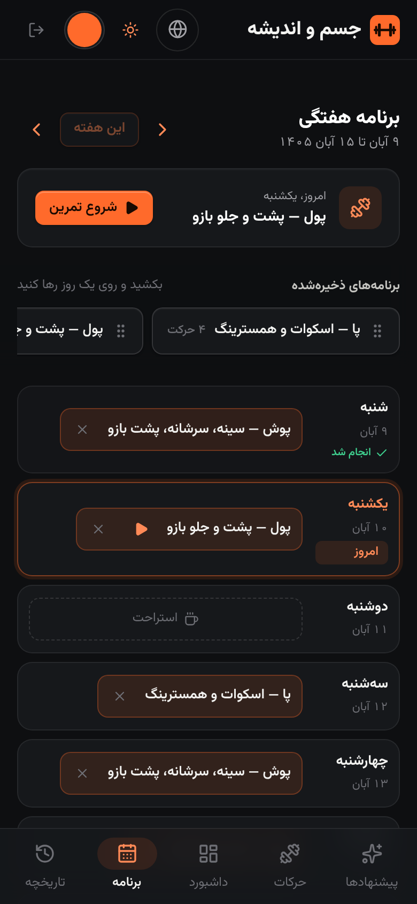
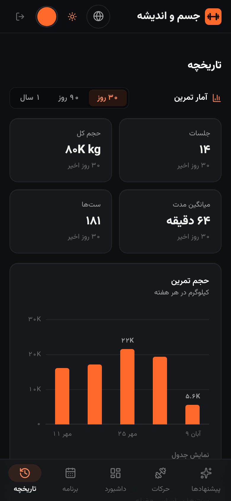

<div align="center">


# CHTH Gym

**Workout tracker, routine planner and training analytics, in five languages.**

Built on Cloudflare Workers with Hono, D1, KV and Google sign-in.

[](https://github.com/chethober/chth.gym/actions/workflows/ci.yml)
[](LICENSE)


[Live site](https://chth.space) · [Screenshots](#screenshots) · [Quick start](#quick-start) · [Deploy](#deploy) · [Contributing](CONTRIBUTING.md)


</div>

---

## Features

| | |
|---|---|
| 🏋️ **Exercise library** | 68 curated exercises with animated GIFs and Persian instructions, plus 1,200+ library movements with muscle maps and English instructions |
| 🗂️ **Routine builder** | Workout splits (Push/Pull/Legs, Upper/Lower) with target sets, reps, rest periods and supersets |
| ⏱️ **Active workout tracker** | Live stopwatch, rest countdown with audio alerts, PR and estimated-1RM detection, plate calculator and warm-up ramp for barbell lifts |
| 📊 **Analytics** | Training volume charts, consistency streaks, a PR hall of fame with estimated 1RM, and a muscle recovery body map |
| 📅 **Weekly plan** | Drag saved routines onto the days of the week and see which ones are done |
| 🚀 **First workout setup** | Preview a starter routine, save experience level and weekly goal, and start as a guest or signed in |
| 🔁 **Repeat and share** | Repeat the last workout, see previous weights and reps, and share a result image |
| 📖 **Public program pages** | Rendered program guides at `/programs`, with canonical URLs, social metadata and a sitemap |
| 🔗 **Trainer program links** | Save and start a shared routine directly from its preview |
| 🔐 **Google sign-in** | Google OpenID Connect, with a demo mode for local testing |
| 🌍 **Five languages** | Persian (RTL, Persian numerals, Solar Hijri calendar), English, Arabic, Russian and Spanish; see [Languages](#languages) |
| 🧩 **Part of CHTH** | The shared CHTH brand kit and footer, linking the other CHTH sites and Telegram bots |

## Screenshots

Screenshots use a local demo account with two weeks of Push/Pull/Legs history.

<table>
  <tr>
    <td width="50%"><br><sub><b>Landing</b>: sign in with Google or browse the programs</sub></td>
    <td width="50%"><br><sub><b>Exercise library</b>: search and filter by muscle and equipment</sub></td>
  </tr>
  <tr>
    <td width="50%"><br><sub><b>Programs</b>: public guides at <code>/programs</code></sub></td>
    <td width="50%"><br><sub><b>Program page</b>: exercises, sets and a link into the app</sub></td>
  </tr>
</table>

**On mobile**

<table>
  <tr>
    <td align="center"><br><sub>Dashboard</sub></td>
    <td align="center"><br><sub>Weekly plan</sub></td>
    <td align="center"><br><sub>Exercises</sub></td>
  </tr>
  <tr>
    <td align="center"><br><sub>History</sub></td>
    <td align="center"><br><sub>Suggestions</sub></td>
    <td align="center"><br><sub>Profile</sub></td>
  </tr>
</table>

## Tech stack

| Layer | Technology |
|---|---|
| Runtime | Cloudflare Workers |
| Backend | Hono |
| Database | Cloudflare D1 (SQLite) |
| Sessions and cache | Cloudflare KV |
| Auth | Google OAuth 2.0 (OpenID Connect) |
| Frontend | Server-rendered HTML, Tailwind CSS, Chart.js, Lucide, Vazirmatn |

## Quick start

**Requirements:** [Node.js](https://nodejs.org/) 18+, npm, and a [Cloudflare](https://www.cloudflare.com/) account for D1 and KV.

```bash
git clone https://github.com/chethober/chth.gym.git
cd chth.gym
npm install
npm run d1:migrate:local   # create the local database
npm run dev                # http://localhost:8787
```

Without Google credentials, a demo-mode sign-in is enabled for local testing.
`node scripts/seed-worst-case.mjs` seeds two local accounts (kind data and worst-case data) for checking layouts.

| Command | Purpose |
|---|---|
| `npm run dev` | Start the Worker locally with Wrangler |
| `npm run build` | Check TypeScript types |
| `npm test` | Run the i18n, activation, public program, landing, appearance, progression, offline and hub tests |
| `npm run d1:migrate:local` | Apply D1 migrations to the local database |
| `npm run d1:migrate:remote` | Apply D1 migrations to the remote database |
| `npm run deploy` | Deploy the Worker |

The tests cover setup preview and persistence, repeat-workout reconstruction, active-session protection, generated script syntax and public program routes. Image sharing and Google sign-in still need a check in a browser or on a device before release.

## Configuration

### Google sign-in

1. Create an OAuth 2.0 client in the [Google Cloud Console](https://console.cloud.google.com/).
2. Set the variables below in `wrangler.jsonc` or with `wrangler secret put`.

| Variable | Description |
|---|---|
| `GOOGLE_CLIENT_ID` | Google OAuth client ID |
| `GOOGLE_CLIENT_SECRET` | Google OAuth client secret (secret) |
| `REDIRECT_URI` | OAuth callback, e.g. `https://chth.space/api/auth/google/callback` |
| `HUB_SECRET` | CHTH hub reporting, stats and banner (optional, secret) |
| `HUB_URL` | The hub's URL, only when not using the `HUB` service binding (optional) |

### Cloudflare resources

Point `wrangler.jsonc` at your own D1 database, KV namespace and domain:

```jsonc
{
  "d1_databases": [
    { "binding": "DB", "database_name": "jesm-db", "database_id": "<YOUR_D1_DATABASE_ID>", "migrations_dir": "migrations" }
  ],
  "kv_namespaces": [
    { "binding": "KV_SESSIONS", "id": "<YOUR_KV_NAMESPACE_ID>" }
  ],
  "routes": [
    { "pattern": "<your-domain>", "custom_domain": true }
  ]
}
```

## Deploy

```bash
npm run d1:migrate:remote
npm run deploy
```

Pushes to `master` run `.github/workflows/deploy.yml`: it runs the tests, applies D1 migrations and deploys, using the `CLOUDFLARE_API_TOKEN` and `CLOUDFLARE_ACCOUNT_ID` repository secrets.

## Languages

The app is written in Persian, and `src/i18n/catalog.json` maps every Persian UI string to
English, Arabic, Russian and Spanish. Pages are translated on the server before they're sent;
a small browser script translates what the app renders later (lists, toasts, dialogs), switches
`fa-IR` number and date formatting to the chosen language, and shows exercise names in English
where the library has them. `npm test` fails when a Persian string has no translation; add it to
the catalog. Visitors pick a language with `?lang=` (kept in the `chth_lang` cookie, shared by
every CHTH site); otherwise the browser's languages decide, with Persian as the fallback.

## CHTH kit and hub

`src/chth-kit/` is generated from the shared CHTH kit (brand tokens, logo, languages, product
links, footer): don't edit it here. The optional CHTH hub integration (`src/hub.ts`) reports
sign-ups, finished workouts, tagged visits and server errors, and answers the hub's signed calls:
`GET /internal/stats` (including growth, activation and retention counts for its 📣 Marketing
screen) and `POST /internal/announcement` (the site banner, kept in KV and shown at the top of
every page). Visits tagged `?ref=` are remembered for 30 days, so a later sign-up counts for that
campaign.

Set `HUB_SECRET` (`wrangler secret put HUB_SECRET`, the same value as `gym` in the hub's
`SOURCE_SECRETS`) to switch it on; without it nothing is sent and the internal routes refuse
every call. Reports go through the `HUB` service binding to the `chth-hub` Worker, or to
`HUB_URL` when that var is set. Deploying a fork to another Cloudflare account: remove the
`services` entry from `wrangler.jsonc`.

## Project structure

```
├── migrations/          D1 migrations (schema, seed data, exercise library, weekly plan)
├── src/
│   ├── auth/            Google OAuth and sessions
│   ├── chth-kit/        Generated CHTH brand kit (do not edit)
│   ├── data/            Preloaded workout programs
│   ├── db/              D1 queries
│   ├── frontend/        Server-rendered app, landing and program pages
│   ├── i18n/            Translation catalog
│   ├── lib/             Domain logic (strength and e1RM, muscle recovery)
│   ├── routes/          API route handlers
│   ├── hub.ts           CHTH hub integration
│   └── index.ts         Hono Worker entry point
├── scripts/             Dataset build scripts, translations, dev seed
├── public/              Static assets (exercise GIFs, icons, service worker)
├── tests/               Node test scripts
├── docs/screenshots/    README screenshots
└── wrangler.jsonc       Cloudflare Workers configuration
```

## Contributing

Contributions are welcome: see [CONTRIBUTING.md](CONTRIBUTING.md). This project follows the [Contributor Covenant](CODE_OF_CONDUCT.md).

Report security issues through a [private security advisory](https://github.com/chethober/chth.gym/security/advisories/new); see [SECURITY.md](SECURITY.md).

## License

[MIT](LICENSE). Third-party data (muscle outlines, exercise library) is credited in [NOTICE.md](NOTICE.md).
